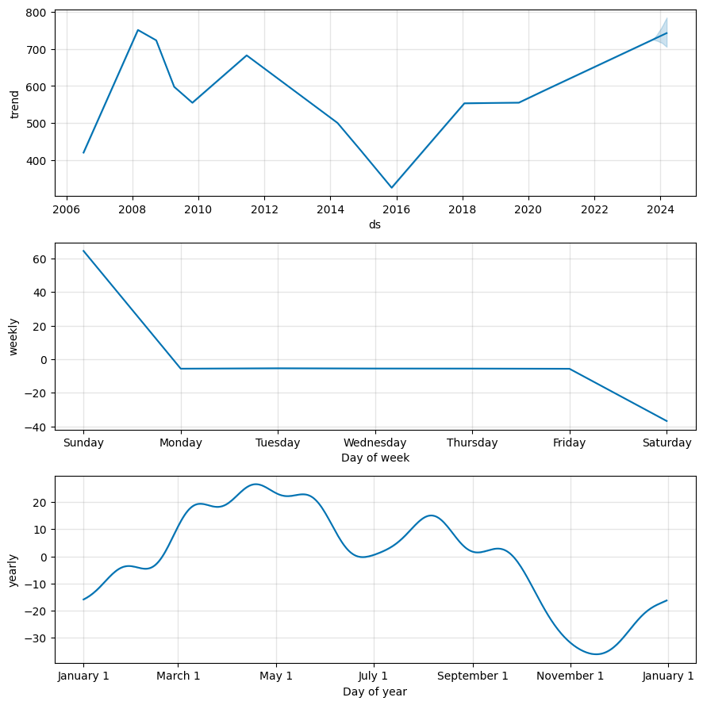
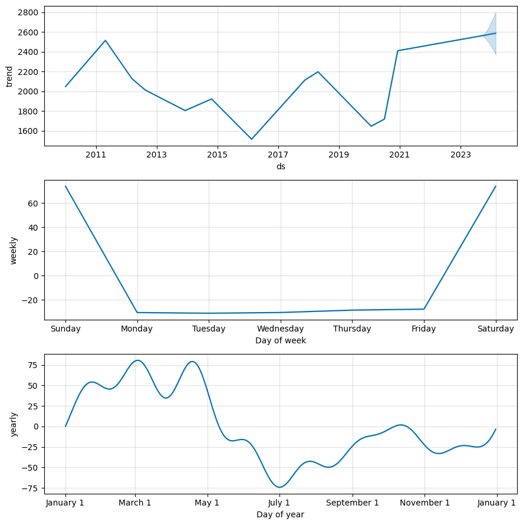
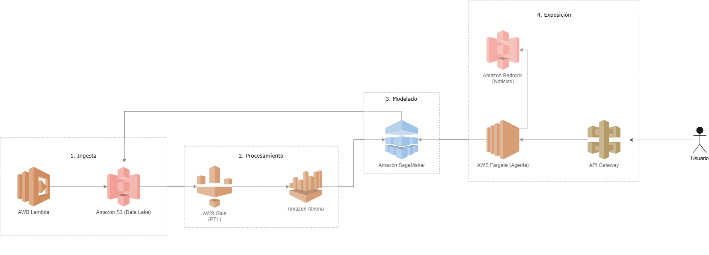

# Proyección de Costos Operativos en Construcción (Data Science & AI)

## Resumen Ejecutivo
Este proyecto analiza las series históricas de precios de tres materias primas (X, Y, Z) para predecir el costo futuro de dos equipos críticos (Equipo1 y Equipo2) en un proyecto de construcción. Se descubrió que la materia prima X era ruido, mientras que el Equipo1 depende en un 82% de la materia prima Y (R² = 0.99), y el Equipo2 depende en un 45% de la materia prima Z (R² = 0.96). Se implementó un modelo de series temporales con Prophet para proyectar los costos a 6 meses con intervalos de confianza, y se construyó un Agente de IA conversacional para interactuar con los resultados.

## Estructura del Proyecto
- **`/datos`**: Archivos CSV originales proporcionados para la prueba (`X.csv`, `Y.csv`, `Z.csv`, `historico_equipos.csv`).
- **`/codigo`**: Notebook `01_Proyecto_Completo.ipynb` con todo el pipeline (limpieza, análisis, Prophet y Agente de IA).
- **`/imagenes`**: Diagrama de arquitectura AWS y gráficas de resultados.

## Metodología y Tecnologías
1. **Limpieza y EDA:** Python, Pandas. Se unificaron formatos de fechas y se verificó la consistencia de los datos (3530 registros).
2. **Análisis de Relación:** Prueba de correlación y Regresión Lineal (Statsmodels). Se descartó la materia prima X por bajo R² individual (0.28) y multicolinealidad.
3. **Modelado y Proyección:** Prophet (Meta) para proyectar Y y Z con intervalos de confianza al 95%. Se justificó un horizonte de 6 meses por el ciclo presupuestal inicial del proyecto.
4. **Agente de IA:** Interfaz en Gradio con lógica de agente (memoria, herramientas de predicción histórica/futura y conocimiento externo).
5. **Arquitectura Cloud:** Diseño en AWS con servicios Serverless.

## Hallazgos Principales
- La materia prima Y explica el 99.3% de la variación del Equipo1.
- La materia prima Z explica el 96.5% de la variación del Equipo2.
- El análisis de estacionalidad reveló que los precios tocan su punto máximo en primavera (marzo/abril) y su punto mínimo en otoño/invierno (octubre/noviembre).

### Análisis de Componentes (Estacionalidad y Tendencia)
El modelo Prophet descompone las series de tiempo para identificar patrones. Se observa claramente el ciclo anual explicado anteriormente.

## Diferencia entre IA Convencional y Agente de IA
- **IA Convencional (Prophet):** Sistema pasivo que recibe datos históricos y genera una predicción numérica. No interactúa ni decide.
- **Agente de IA (Chatbot):** Sistema autónomo que **percibe** la pregunta del usuario, **decide** qué herramienta usar (predecir el futuro, consultar el pasado, leer noticias o recordar la conversación), **ejecuta** la acción y mantiene **memoria** para dar una respuesta integral.

## Arquitectura Cloud (AWS)

*Flujo:* 
1. **Ingesta:** Lambda recolecta datos y los guarda en S3.
2. **Procesamiento:** Glue limpia los datos y Athena permite consultarlos.
3. **Modelado:** SageMaker entrena Prophet y guarda las predicciones en S3.
4. **Exposición:** El usuario interactúa vía API Gateway, que conecta con el Agente en Fargate. El Agente consulta las predicciones en SageMaker y el contexto en Bedrock.

## Cómo ejecutar el código
1. Abrir el notebook `01_Proyecto_Completo.ipynb` (ubicado en la carpeta `/codigo`) en Google Colab.
2. Ejecutar todas las celdas en orden.
3. El código instalará las dependencias, limpiará los datos, entrenará Prophet y desplegará el Agente en Gradio.
